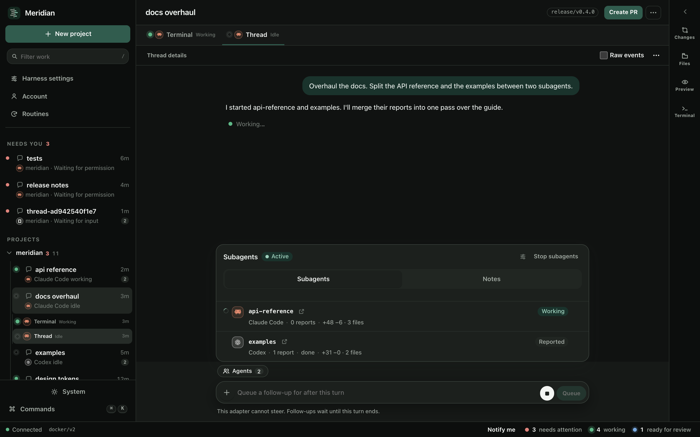
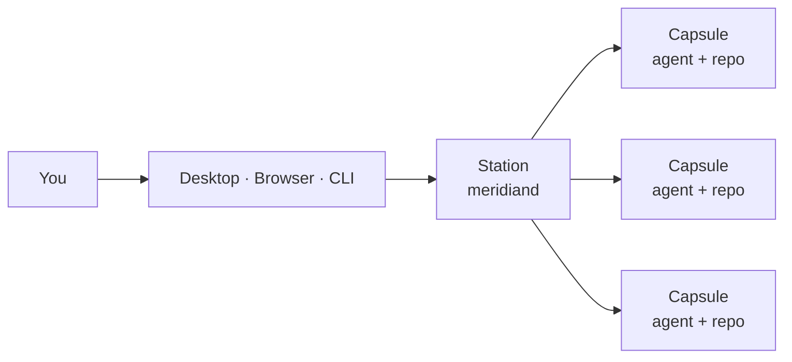

<div align="center">


# Meridian

**Your own cloud agent station.**

Run Claude Code, Codex, and other coding agents in disposable workspaces,
on your laptop, your server, or your cluster.

[](https://github.com/OrlojHQ/meridian/actions/workflows/ci.yml)
[](https://github.com/OrlojHQ/meridian/releases)
[](LICENSE)

[Quick start](#quick-start) · [Features](#features) · [How it works](#how-it-works) · [Docs](#documentation)

</div>


## What is Meridian?

Cloud coding agents are great: hand off a task, close your laptop, come back
to a pull request. But they run in someone else's cloud, with someone else's
limits.

Meridian is that experience on hardware you control. You run one **Station**,
and every task gets its own **Capsule**: a throwaway sandbox with a fresh
clone of your repo and the coding agent you pick, such as Claude Code, Codex,
OpenCode, Pi, or your own. Agents can install, test, and rewrite freely
without touching your machine. You watch, steer, and review from the desktop
app, your browser, or your terminal, then ship the result or throw it away.

You talk to that agent in a **Thread**. It is the real agent, with its own
tools, slash commands, and models, not a stand-in. A Thread can be a quick
one-off task, or a **lead**: one long-running conversation for an area of your
codebase that you come back to for days or weeks. The lead keeps the context,
hands pieces of work to subagents in their own Capsules, and reads what they
report back. Subagents can even run a different agent, like a Claude Code lead
with Codex subagents. You pick up where you left off instead of explaining
everything again in a new session.

Bring the agents and models you already use. Use it alone or share one Station
with your team.



## Features

- **A clean workspace for every task.** Each Capsule is an isolated sandbox:
  a container, a gVisor sandbox, or a microVM. Run as many as you like, side
  by side.
- **Chat with your agents.** Follow along live, answer questions, approve
  tool use, and switch models mid-session, in the desktop app or any browser.
  Prefer a terminal? That works too.
- **Lead agents with subagents.** Let one agent split a big task across
  several Capsules, within limits you set.
- **Routines.** Put recurring work on a schedule, like a weekly dependency
  bump or a nightly flaky-test triage. Each run starts a fresh Capsule with a
  time limit, and nothing ships until you review it.
  [Learn more](docs/adr/0057-routines.md).
- **Project notes.** Write down what every agent in a Project should know,
  like your pull request style or who owns which directory, once. Agents can
  suggest changes, and you approve each one. [Learn more](docs/review-ui.md#notes).
- **Review before anything ships.** Diffs with line comments, a file browser,
  live previews of dev servers, and one-click GitHub pull requests.
- **Any agent, any model.** Claude Code, Codex, OpenCode, Pi, DeepSeek
  Harness, or any CLI or [ACP](https://agentclientprotocol.com) agent. Sign
  in as usual, add an API key, or point at your own model server.
- **Your setup comes along.** `meridian import` brings your agent settings,
  skills, and MCP servers into every Capsule. Logins and keys never do.
- **Snapshot, fork, and rewind.** Save a Moment of any workspace, branch off
  to try another approach, or roll back.
- **Built for teams.** Sign in with your identity provider, keep work private
  per person, and keep an audit log.
- **Scriptable.** Every action is also a CLI command and an
  [OpenAPI](api/openapi.yaml) endpoint.


## Quick start

You need [Docker](https://docs.docker.com/get-docker/).

**Desktop app** (macOS). It runs a Station on your computer for you:

```console
brew install --cask orlojhq/tap/meridian-desktop
```

**CLI and daemon** (macOS or Linux):

```console
brew install orlojhq/tap/meridian
brew services start meridian
meridian tui --harness claude
```

Enter a repository (`owner/repo` or a clone URL), and Meridian starts your
first Capsule. Sign in to the agent once. The same workspace is also in your
browser at [http://127.0.0.1:8080/ui/](http://127.0.0.1:8080/ui/).

For the Linux desktop app, release archives, building from source, API keys,
and troubleshooting, see the [install guide](docs/install.md).

## Supported agents

| Agent | Terminal | Chat | Lead with subagents |
| --- | :---: | :---: | :---: |
| Claude Code | ✓ | ✓ | ✓ |
| Codex | ✓ | ✓ | ✓ |
| OpenCode | ✓ | ✓ | ✓ |
| Pi | ✓ | ✓ | ✓ |
| DeepSeek Harness (preview) | | ✓ | ✓ |

Official images are pinned by checksum, built for `amd64` and `arm64`, and
signed on every release. Any other agent can run as a
[custom harness](docs/harness-configuration.md).

## How it works



- **Station**: the `meridiand` daemon you run. It starts Capsules on Docker
  or [Kubernetes](docs/kubernetes-agentsandbox.md), holds your credentials,
  and serves the workspace that the desktop app and browser show.
- **Capsule**: a disposable sandbox with the agent you picked and one clone
  of your repo. On Docker it is a container; on Kubernetes it can also be a
  gVisor sandbox or a Kata microVM.
- **Thread**: a conversation with that agent, running in its Capsule. A lead Thread is one you keep coming back to, and it can start
  subagents.

## Security

Meridian treats repositories, agents, and everything they run as untrusted.
Capsules never get your Docker socket, your home directory, or your API keys.
Secrets and transcripts are encrypted at rest, and no branch is pushed or
pull request opened until you approve the exact changes.

Meridian is built for one person or a team of trusted teammates. Capsules on
Docker share one kernel, and even stronger runtimes are not a supported
boundary between mutually hostile tenants, so don't host it for untrusted
users. See the [threat model](docs/threat-model.md) and
[security policy](SECURITY.md).

## Documentation

| Get started | Use | Operate |
| --- | --- | --- |
| [Install](docs/install.md) | [Workspace and previews](docs/review-ui.md) | [Operations](docs/operations.md) |
| [Bring your setup](docs/personal-harness-setups.md) | [CLI and TUI](docs/cli-and-tui.md) | [Team mode](docs/operations.md#team-mode) |
| [Harness configuration](docs/harness-configuration.md) | [Moments](docs/moments-and-lineage.md) | [Kubernetes](docs/kubernetes-agentsandbox.md) |
| [Harness adapters](docs/harness-adapters.md) | [Project checks](docs/checks.md) | [Threat model](docs/threat-model.md) |
| | [GitHub App](docs/github-app.md) | |
| | [Prepared environments](docs/prepared-environments.md) | [Architecture decisions](docs/adr/) |

## Status

Meridian is pre-1.0. APIs and on-disk formats may change between minor
releases. See the [changelog](CHANGELOG.md).

## Contributing

Issues and pull requests are welcome. Read [CONTRIBUTING.md](CONTRIBUTING.md)
first, and open an issue to discuss large changes.

## License

[Apache License 2.0](LICENSE). Meridian is developed by
[OrlojHQ](https://github.com/OrlojHQ) and is independent of
[Orloj](https://github.com/OrlojHQ/orloj).
