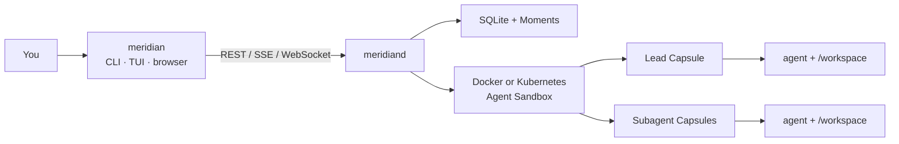

# Meridian

**Self-hosted cloud agents. Run Claude Code, Codex, OpenCode, Pi, or DeepSeek
Harness in disposable workspaces, let a lead agent hand work to subagents, then
review and ship what they built.**

[](https://github.com/OrlojHQ/meridian/actions/workflows/ci.yml)
[](https://github.com/OrlojHQ/meridian/releases)
[](LICENSE)

Coding agents do their best work when you let them run: install packages, run
the test suite, rewrite half the repo, try three approaches at once. That is
exactly what you don't want happening in your only checkout, on your laptop,
one attempt at a time.

Meridian gives every agent session its own **Capsule**: a throwaway container
with a fresh clone of your repository at `/workspace` and the agent you picked
already installed. Hand it a task from the browser, follow along in a chat or
its terminal, let it start subagents for the parts that can run in parallel,
review the diff, and open a pull request when you like the result. When you
don't, throw it away.

It runs on your machine or your cluster, with the agents and models you
already pay for, or your own model server.

## What you get

### A workspace per task

Each Capsule is a non-root container with bounded CPU, memory, and process
count, a fresh clone, and one agent. It never receives your Docker socket,
your home directory, or Meridian's credentials. Prepared environments cache
your project's setup step, so the next Capsule on the same commit starts
without reinstalling.

### Agents you can talk to in the browser

Start a task and the agent works in a **Thread**: a chat you can follow live,
answer, and steer from the web UI.

- Approve or deny the agent's tool use, and answer the questions it asks.
- Switch the model and reasoning effort from the message box, mid-session.
- Type `/` for the agent's own slash commands.
- The **Inbox** shows every Capsule by status, puts sessions that need you
  first, and lets you peek at and answer them in place. Browser notifications
  tell you when an agent is waiting.
- Prefer a terminal? Every agent also runs in a live terminal in the browser
  or in the `meridian tui` dashboard.

Transcripts are encrypted at rest.

### A lead agent with subagents

Tick **Lead agent with subagents** when you start a task and the agent can
split the work: it starts subagents, each in its own Capsule, sends them
instructions, waits for their reports, and reads their diffs.

- You set the limits: how many subagents, how many at once, a deadline, and
  whether each spawn needs your approval.
- The **Agents** list in the lead's composer shows every subagent's status and
  model; click one to open it.
- Subagents ask **you**, never the lead, for permission to use tools.
- A lead can propose a pull request; only you can approve it.

### Any agent, any model

- **Five official agents**: Claude Code, Codex, OpenCode, Pi, and DeepSeek
  Harness, each pinned by checksum and signed on every release.
- **Your existing setup**: import your configuration, skills, and plugins with
  **Import my setup**. Login caches and history stay behind.
- **Your models**: sign in to the agent as you do today, add an OpenAI or
  Anthropic API key once, or point Meridian at your own server: vLLM, Ollama,
  LiteLLM, or any OpenAI- or Anthropic-compatible endpoint, with the reasoning
  effort levels it supports. Keys never enter a Capsule.
- **Other agents**: any CLI agent runs as a custom harness, and any
  [Agent Client Protocol](https://agentclientprotocol.com) agent can also run
  as a browser Thread through the built-in `acp` adapter.

### Snapshot, fork, and rewind

Capture a **Moment** of the workspace at any point. Shard it into a new Capsule
to try a different approach in parallel, or rewind to an earlier Moment
without losing anything that came after.

### Review before anything leaves the box

The browser workspace has syntax-highlighted diffs with line comments you can
send back to the agent, a file browser, a live terminal, and authenticated
previews of dev servers running inside the Capsule. Push a reviewed branch and
open a GitHub pull request, or sync the changes into your local checkout.
Approval is bound to the exact tree you reviewed.

### Script everything

Every UI action is also a CLI command and a documented
[OpenAPI](api/openapi.yaml) endpoint.

## Quick start

You need Docker. Then pick an install path.

### From a release

Download the archive for your platform from
[Releases](https://github.com/OrlojHQ/meridian/releases) (`macOS` or `linux`,
`arm64` or `amd64`) and [verify it](docs/operations.md#verify-a-release):

```console
VERSION=0.3.0
curl -fsSLO "https://github.com/OrlojHQ/meridian/releases/download/v${VERSION}/meridian_${VERSION}_macOS_arm64.tar.gz"
tar -xzf "meridian_${VERSION}_macOS_arm64.tar.gz" meridian meridiand
```

Start the daemon, then open the dashboard in a second terminal:

```console
./meridiand --provider=docker
./meridian tui --harness claude
```

Enter a repository (`owner/repo` or a clone URL) and submit. Meridian pulls
the Claude Code image, starts a Capsule, and hands you its terminal. Sign in
there once; Threads in that Capsule use the same login.

Then open the browser workspace at
[http://127.0.0.1:8080/ui/](http://127.0.0.1:8080/ui/). It asks once for the
installation token, which `meridiand` wrote to
`~/Library/Application Support/meridian/api-auth/installation.token` on macOS
or `~/.config/meridian/api-auth/installation.token` on Linux.

Swap `--harness claude` for `codex`, `opencode`, or `pi`.

### From source

You need Go 1.26.5, Bun 1.3.0, Git, Make, and Docker with BuildKit.

```console
make bootstrap
make try-claude
```

That builds everything, starts `meridiand` on loopback, and opens the same
dashboard. Also available: `make try-codex`, `make try-opencode`,
`make try-pi`.

### Use API keys or your own model server

Threads can also use a reusable **provider connection** instead of a sign-in:
an OpenAI or Anthropic API key, or your own endpoint. Connections go through
Meridian's provider gateway, so `meridiand` needs an HTTPS address that
Capsules can reach (for example, behind a reverse proxy or Tailscale):

```console
./meridiand --provider=docker --provider-gateway-url=https://meridian.example
./meridian harness connect openai-compatible \
  --base-url https://models.example --model glm-5.3-flash \
  --effort low,high,max --stdin < key.txt
```

See [Bring your harness setup](docs/personal-harness-setups.md) for every
option, including vLLM, Ollama, and LiteLLM.

### Troubleshooting

- **`cannot reach Docker`**: start Docker (Docker Desktop, OrbStack, or the
  Docker service). On Linux, your user needs access to the Docker socket. Use
  `--docker-host` to point at a different engine.
- **Port 8080 is already in use**: pick other ports and point the CLI at them:

  ```console
  ./meridiand --provider=docker --listen=127.0.0.1:18080 --preview-listen=127.0.0.1:18081
  ./meridian --server http://127.0.0.1:18080 tui --harness claude
  ```

  The browser workspace is then at `http://127.0.0.1:18080/ui/`.
- **`data directory is in use`**: another `meridiand`, or a maintenance
  command, already holds that data directory. Stop it, or give this daemon
  its own `--data-dir`. Never point two daemons at one directory.
- **macOS says `meridiand` cannot be opened**: the binaries are not notarized,
  and archives downloaded in a browser are quarantined. After
  [verifying the archive](docs/operations.md#verify-a-release), run
  `xattr -d com.apple.quarantine meridian meridiand`. Downloads made with
  `curl`, as above, are not quarantined.

## Supported agents

| Agent | Image | Terminal | Browser Threads | Lead with subagents |
| --- | --- | :---: | :---: | :---: |
| Claude Code | `ghcr.io/orlojhq/meridian-capsule-claude` | ✓ | ✓ | ✓ |
| Codex | `ghcr.io/orlojhq/meridian-capsule-codex` | ✓ | ✓ | ✓ |
| OpenCode | `ghcr.io/orlojhq/meridian-capsule-opencode` | ✓ | ✓ | ✓ |
| Pi | `ghcr.io/orlojhq/meridian-capsule-pi` | ✓ | ✓ | ✓ |
| DeepSeek Harness | `ghcr.io/orlojhq/meridian-capsule-dsh` | | ✓ | ✓ |

Every image pins its agent release by checksum, is built for `amd64` and
`arm64`, and is signed with Sigstore on each release. DeepSeek Harness is a
developer preview with no terminal UI; it runs only as a browser Thread and
uses a provider connection for its model. Any other CLI agent can run as a
custom harness through [`.meridian/project.yaml`](docs/harness-configuration.md),
and an Agent Client Protocol agent can run as a browser Thread through the
[`acp` adapter](docs/harness-adapters.md#adding-an-acp-harness).

## How it works



| Piece | Role |
| --- | --- |
| `meridiand` | Daemon: API, storage, Capsule lifecycle, provider gateway, embedded web UI |
| `meridian` | CLI and terminal dashboard |
| Capsule | Container with `capsuled` (a small supervisor) and one agent |

You run one daemon. It starts Capsules on local Docker or, for a cluster, on
[Kubernetes Agent Sandbox](docs/kubernetes-agentsandbox.md), and stores
Moments next to its SQLite database. A lead agent asks for subagents through a
mailbox inside its own Capsule; the daemon picks up each request, checks it
against the limits you set, and starts the subagent. No Capsule ever holds a
Meridian credential.

## Security model

Meridian treats repositories, agent output, terminals, and Capsule processes as
hostile.

- The API listens on loopback by default and requires an installation token.
- Only `meridiand` touches the Docker socket; Capsules never get it, host
  paths, or control-plane credentials.
- Secrets and transcripts are encrypted at rest, and secrets are scoped to a
  purpose, such as one clone or one pull request.
- Model API keys stay in the daemon; Capsules get a revocable gateway lease.
- Subagents ask you, not their lead, for permission, and a lead can propose a
  pull request but never approve one.

Meridian is built for **one trusted person** running agents on their own
machine or cluster. Docker containers are not a boundary between mutually
hostile tenants, so do not host Meridian for untrusted users. Read the
[threat model](docs/threat-model.md) and [security policy](SECURITY.md).

## Status

Meridian is pre-1.0. APIs and on-disk formats may change between minor
releases; see the [changelog](CHANGELOG.md).

## Documentation

**Use**
- [CLI and terminal dashboard](docs/cli-and-tui.md): `thread spawn`,
  [leads and subagents](docs/cli-and-tui.md#leads-and-subagents), the board,
  sync, ship
- [Browser workspace and previews](docs/review-ui.md)
- [Bring your harness setup](docs/personal-harness-setups.md): imports, API
  keys, and self-hosted models
- [Prepared project environments](docs/prepared-environments.md)
- [Moments and lineage](docs/moments-and-lineage.md): capture, shard, rewind,
  seal

**Extend**
- [Harness configuration](docs/harness-configuration.md): `.meridian/project.yaml`
- [Harness adapters](docs/harness-adapters.md): official images, the
  structured protocol, and ACP agents

**Operate**
- [Operations](docs/operations.md): install, verify, back up, Compose, Helm
- [Docker development](docs/docker-development.md)
- [Kubernetes Agent Sandbox](docs/kubernetes-agentsandbox.md)
- [Threat model](docs/threat-model.md)
- [Architecture decisions](docs/adr/)

## Contributing

Issues and pull requests are welcome. Start with
[CONTRIBUTING.md](CONTRIBUTING.md), and discuss large changes in an issue
first.

```console
make bootstrap
make build test lint ui-build helm-test
```

## License

[Apache License 2.0](LICENSE). Meridian is developed by
[OrlojHQ](https://github.com/OrlojHQ) and is independent of
[Orloj](https://github.com/OrlojHQ/orloj).
