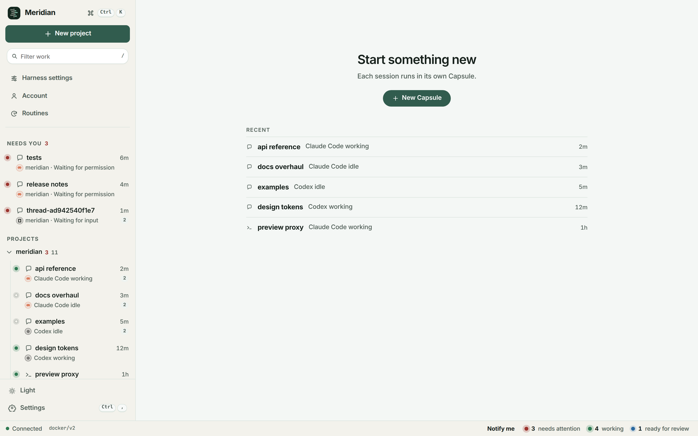
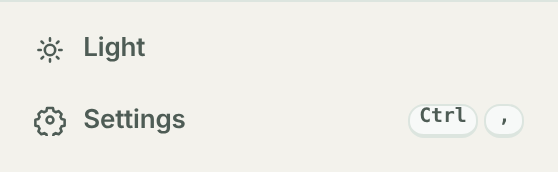
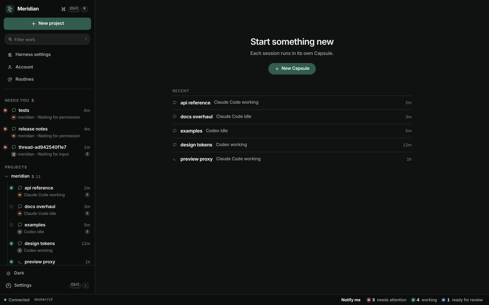
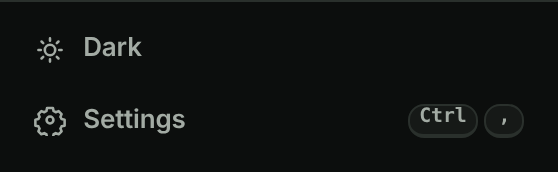
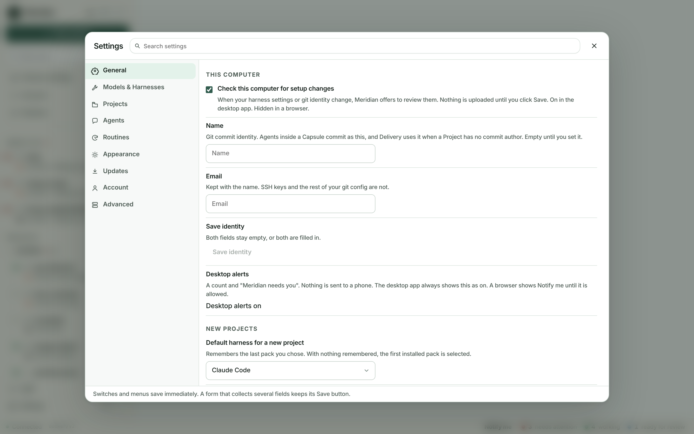
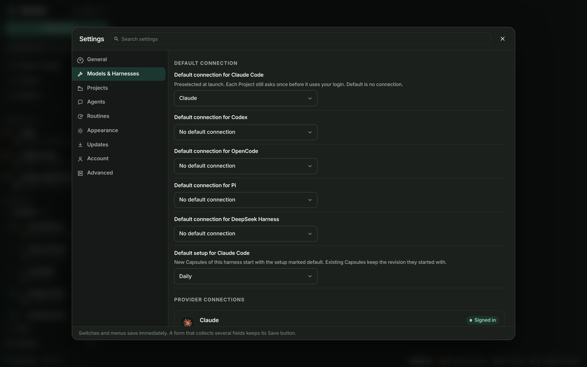
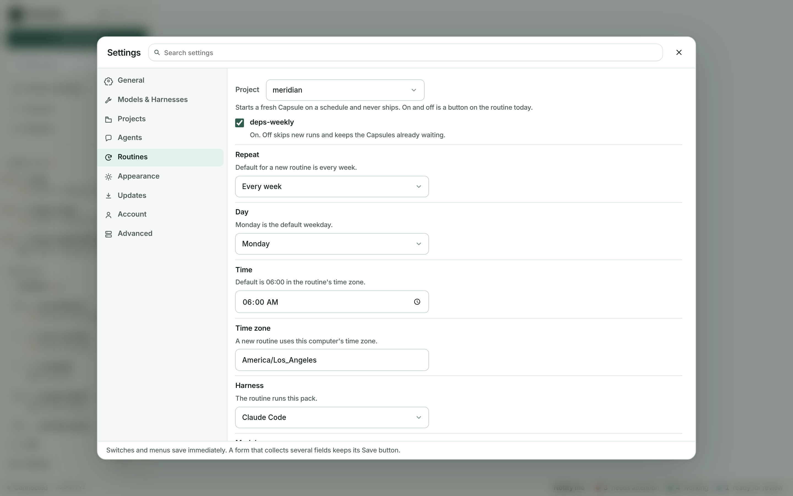
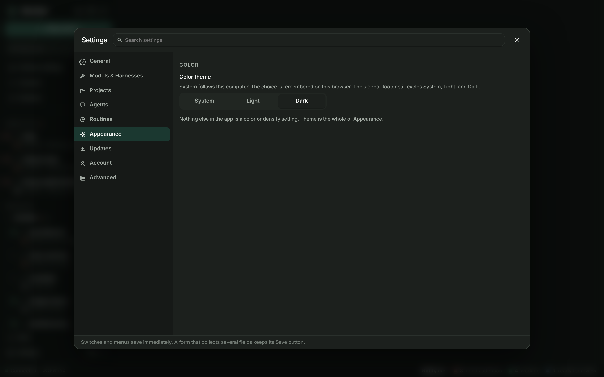
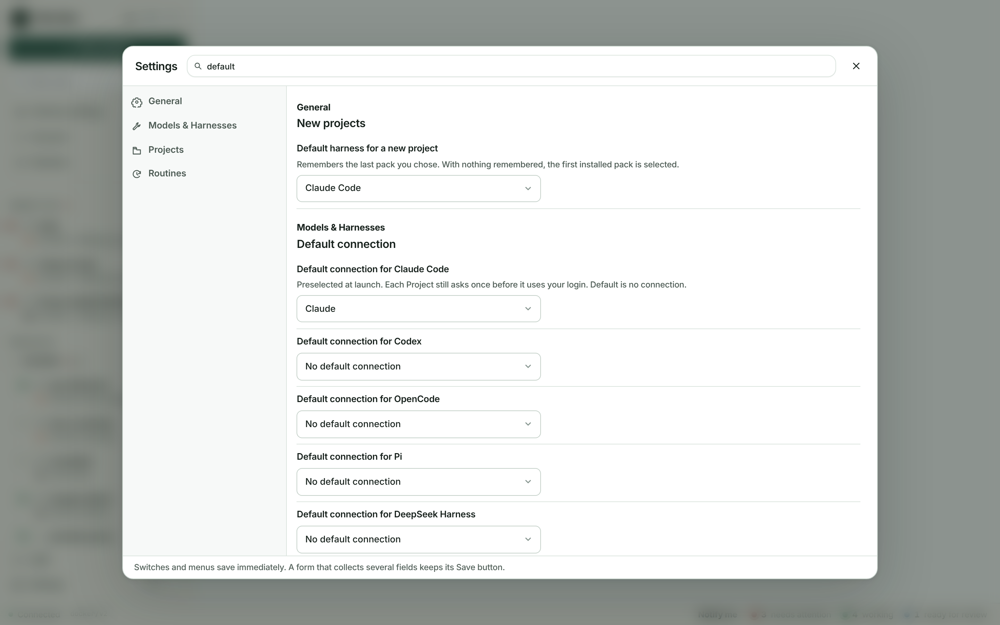
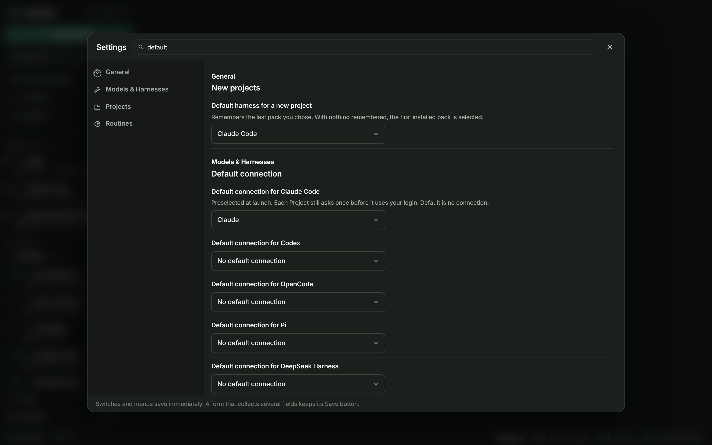

# Settings window

Design mock for a single Settings window. This is not the feature. Nothing in the mock is saved, and the old settings pages are unchanged. Sign off on this layout before any of it is built.

The mock is development-only. From `frontend/`:

```console
bun run dev
```

Then open `/ui/?design=settings`. Useful query parameters:

| Parameter | Effect |
| --- | --- |
| `section` | `general`, `models`, `projects`, `agents`, `routines`, `appearance`, `updates`, `account`, `advanced` |
| `q` | Fills the search box and filters rows |
| `open=0` | Leaves the window closed so the gear is visible on its own |
| `shots=1` | Sample workspace, so the shell is populated |
| `theme` | `light` or `dark`, with `shots=1` |

`Cmd+,` on macOS and `Ctrl+,` elsewhere toggles the window. Escape closes it. The screenshots below were taken at 1440×900 on Linux, so the shortcut draws as Ctrl+, . The same control draws ⌘, on macOS.

## Gear

Settings takes the bottom slot in the sidebar footer, the row Commands uses today, under the color-theme cycle. That footer is on every screen. The page has no title bar of its own, so the footer is the spot that stays visible. The shortcut sits on the right of the row.

The shared icon file has no cog. The mark on Harness settings is three sliders. Settings uses a cog drawn with that file's 20 by 20 view box, stroke, and round caps, so the feature can add the same path next to the slider mark.









Harness settings, Account, and Routines stay in the sidebar in this mock, so the cog can be compared with the links it would replace. The proposal is that those links become jumps into the matching section, or go away.

## Commands

Commands does not stay in the sidebar. The palette already opens with `Cmd+K` or `Ctrl+K` from anywhere, and the footer slot is now Settings. The filter field under New project is a different search: it only narrows the activity list, and its `/` hint should keep meaning that.

The visible control moves to the sidebar header, to the right of the name, as the command mark plus the shortcut. It stays on screen without spending the bottom row, and it does not turn the activity filter into a second command box.


## Window

Settings opens as a dialog over the workspace: a section list pinned to the left edge, the settings on the right, and a search box in the header. Headings, labels, and controls in the content pane all start at the left. A control sits under its label. It is not a column of controls on the right. Switches and menus save immediately. A form that collects several fields keeps its Save button. That matches how the app works today (the theme, a default connection, and notes delivery save on change; checks, the environment, git identity, and a routine keep an explicit save).

Whether this should be a dialog or a separate window is an open question, below.

## Sections

The issue's list was adjusted to the settings that exist.

| Section | What moves here |
| --- | --- |
| General | This computer, git identity, desktop alerts, the harness remembered for a new project |
| Models & Harnesses | Provider connections, the default connection and default setup for each harness, import |
| Projects | Per-project packs, checks, environment, and which Threads receive notes |
| Agents | Per-lead subagent limits |
| Routines | Per-project routines |
| Appearance | Color theme. Nothing else in the app is a color or density setting |
| Updates | The desktop update check |
| Account | Sign-in, GitHub, sessions, personal access tokens, members |
| Advanced | Station, and installation facts that are not preferences |

Projects, Agents, and Routines are scoped. The section starts with a Project or Lead menu because those settings are not installation-wide.

## Inventory

"Where" is the screen today. Defaults are what a new installation, project, lead, or routine starts with.

### General

| Setting | Where | Control | Default |
| --- | --- | --- | --- |
| Check this computer for setup changes | Harness settings. Desktop only; a browser does not render it | Checkbox | On |
| Name | Harness settings, under What Capsules inherit | Text, 320 characters, with Save identity | Empty |
| Email | Same form | Email, 320 characters | Empty |
| Desktop alerts | Status bar | Desktop: the text "Desktop alerts on", no switch. Browser: Notify me until permission is granted, then Alerts on, or Alerts blocked | Desktop is always on. A browser has not asked yet |
| Default harness for a new project | New project dialog. Stored in this browser as `meridian.newProjectHarness` | Select of installed packs | The last pack chosen, otherwise the first installed pack |

Git identity requires both fields or neither. SSH keys and the rest of git config are not kept.




### Models & Harnesses

| Setting | Where | Control | Default |
| --- | --- | --- | --- |
| Default connection for each harness | Harness settings, What Capsules inherit | Select | No default connection |
| Default setup for each harness | The setup card's Use by default | Select in this mock; today it is a button on the card | No setup until one is marked default |
| Provider | Add a connection | Select | OpenAI |
| Connection name | Add a connection | Text, 128 characters | Empty. Omitted for a ChatGPT plan sign-in |
| API key | OpenAI, and the Claude fallback | Password | Empty |
| Claude sign-in | Add a connection, provider Claude | Sign in with Claude, or an API key or a setup token | Sign-in is the first path |
| ChatGPT plan | Add a connection | Sign in once | Not connected |
| Base URL | A compatible endpoint | Text | Empty |
| Default model | A compatible endpoint | Select after Load models, or text | Empty until models load; the server's suggestion is then selected |
| Use plain HTTP to a private-network server | A compatible endpoint, and only when the installation allows it | Checkbox | Off |
| Review this computer's setup | Harness settings and the first-run steps | Button that opens the desktop import window. A browser points at `meridian import` or a folder | Nothing imported |

A default connection is preselected at launch. Each Project still asks once before it uses the login.




### Projects

These apply to one Project. Today they are the Settings tab on the project page, except notes delivery, which is on the Notes tab.

| Setting | Where | Control | Default |
| --- | --- | --- | --- |
| Harness packs | Project settings | Add a pack. The mock shows the packs already on the project | None until one is added |
| Check name, command, timeout | Project settings, Checks | Text rows | No commands. The editor offers one blank row named test, timeout 600 seconds |
| Automatically send failures back to the agent | Checks | Checkbox | On |
| Attempts | Checks | Number | 3. 0 runs the checks once and stops |
| Reuse matching prepared environments | Project environment, behind a disclosure | Checkbox | On |
| Setup script | Project environment | Text area, 4096 characters, plus Save environment and Rebuild on next launch | Empty |
| Deliver to | Notes tab | Select: Every Thread, Lead Threads and their subagents, No Thread | Every Thread |

Saved checks and environment changes apply to future Capsules.

### Agents

These apply to one lead Thread. Today they are Subagent settings on that Thread. A new lead starts here:

| Setting | Where | Control | Default |
| --- | --- | --- | --- |
| Pause without you | Subagent settings | Select: 1 hour, 4 hours, 1 day, 3 days | 1 day |
| Run at once | Subagent settings | Select, 1 to 16 | 4 |
| Clean up finished subagents | Subagent settings | Select: 15 minutes, 1 hour, 4 hours, 1 day, Never | 1 hour |
| Approve each spawn | Subagent settings | Switch | Off. The lead starts subagents on its own |

Starting a Capsule is not a persisted setting. The New Capsule dialog still asks Thread or CLI, Lead agent with subagents (off), and Approve each subagent spawn (off). Include Project notes follows Deliver to.

### Routines

A routine belongs to a Project. Today the list is the Routines page and the project settings. A new routine is on, and starts from:

| Setting | Control | Default |
| --- | --- | --- |
| On | Button (Turn on / Turn off) today. The mock uses a switch | On |
| Repeat | Select: Every hour, Every day, Weekdays, Every week, Custom cron | Every week |
| Day | Select, when weekly | Monday |
| Time | Time | 06:00 |
| Time zone | The time zone picker | This computer's time zone |
| Harness | Select of the project's structured packs | The first pack that can run a routine |
| Model | Select, or text when the harness has not reported models | Empty, which means the harness default |
| Effort | Select or text | Empty, which means the model's default |
| Include Project notes | Switch | Off |
| Stop a run after (minutes) | Number | 120 |
| Catch up a missed run within (minutes) | Number | 60 |
| Pause firing while this many runs wait for you | Number | 5 |
| Prompt | Text area | Empty. Required to save |
| Name | Text, 1 to 48 lowercase letters, digits, or dashes | Empty |



### Appearance

| Setting | Where | Control | Default |
| --- | --- | --- | --- |
| Color theme | Sidebar footer. Cycles System, Light, Dark. Stored as `meridian.theme`; System removes the stored value | Three-way choice in the window. The footer cycle stays | System |




### Updates

Desktop only. A browser has no updater.

| Setting | Where | Control | Default |
| --- | --- | --- | --- |
| Check for updates | A card in the sidebar footer when a release is available, and a manual check | Button. Update and restart installs. Remind me later hides that version for 24 hours | The check runs on launch, every four hours, after wake, and when the window is shown again. There is no switch to turn it off |

### Account

| Setting | Where | Control | Default |
| --- | --- | --- | --- |
| Signed in as, email, role | Account, team mode | Text | The signed-in member |
| Sign out | Account | Button | — |
| GitHub | Account, and the first-run step | Connect or Reconnect | Not connected |
| Sessions | Account | Revoke, except the current browser. Sessions end after 12 hours idle or 7 days | The current session |
| Token name | Personal access tokens | Text, 64 characters | Empty |
| Expires after | Personal access tokens | Select: 30 days, 90 days, 1 year | 90 days |
| Read-only | Personal access tokens | Checkbox | Off |
| Members | Account, admins | Role, and disable. The last enabled admin cannot be demoted or disabled | — |

Single-user mode has no profile. Team mode, when the installation can still be claimed, is a one-time claim with the installation token and cannot be undone.

### Advanced

| Setting | Where | Control | Default |
| --- | --- | --- | --- |
| Station | Sidebar, when the desktop shell can switch Stations. Otherwise a Station button. A browser does not show it | Button: Switch or manage Stations… The page never receives the station list | This computer |
| Station shortcuts | The station menu | ⌘1–⌘9, or Ctrl+1–Ctrl+9 | The first nine saved Stations |
| Provider gateway | A note on provider connections when it is off | Text. An administrator sets it on the daemon | On when the daemon started it |
| Team mode | Account, before the installation is claimed | One-time claim | Off until claimed |

## Search

The box filters by the setting's name and its description. Sections with no match drop out of the list. Clearing the box, or choosing a section, restores that section.





## Left where it is

These are view memory or a choice made while starting work, not a setting to register:

| Item | Where | Default |
| --- | --- | --- |
| Capsule tools panel width | `meridian.contextPanel.width` | The layout default. Open and closed are not stored |
| Collapsed projects in the sidebar | `meridian.sidebar.collapsedProjects` | Expanded |
| Raw events | Thread toolbar | Off, for that view |
| Show all subagents | Board | Off, for that view |
| Update snooze | `meridian.desktop.update.later` | None. Set by Remind me later |
| Isolation, repository, and a private repository | New project dialog | No isolation requirement. The repository is whatever was typed |
| Thread or CLI, lead, include notes | New Capsule dialog | Thread when the harness supports it. Lead is off. Notes follow the project |
| Delete project | The project page | — |

## Open questions

1. Dialog or a separate window? The mock is a dialog, like the command palette and New Capsule, because the page is the whole desktop window. A separate window would stay open while the workspace changes underneath it.
2. Should per-project and per-lead settings live here, behind a Project or Lead menu, or stay on the project page and the lead Thread with a link from Settings?
3. Is the save split right: immediate for a switch or a menu, and a Save button for a form that collects several fields?
4. Do the sidebar links for Harness settings, Account, and Routines go away, or stay as jumps into those sections?
5. Does the footer theme cycle stay once Appearance exists?
6. Confirm that launch-time choices and the view memory above stay out of the registry.
