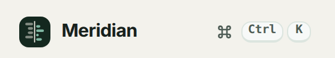
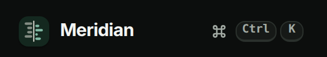
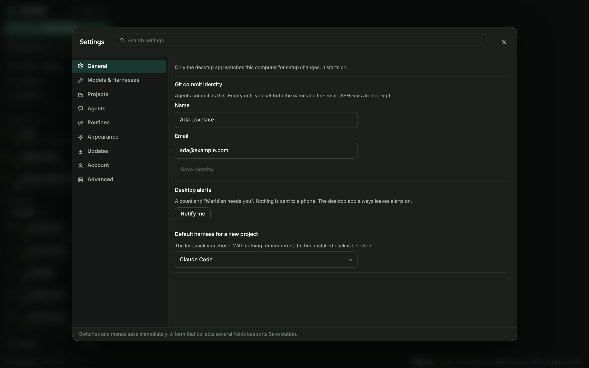
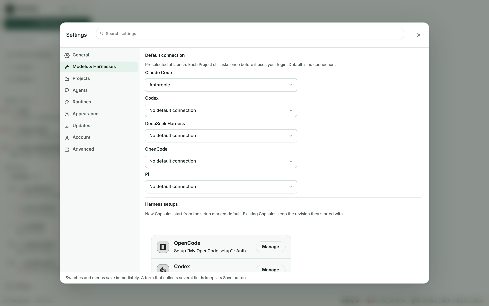
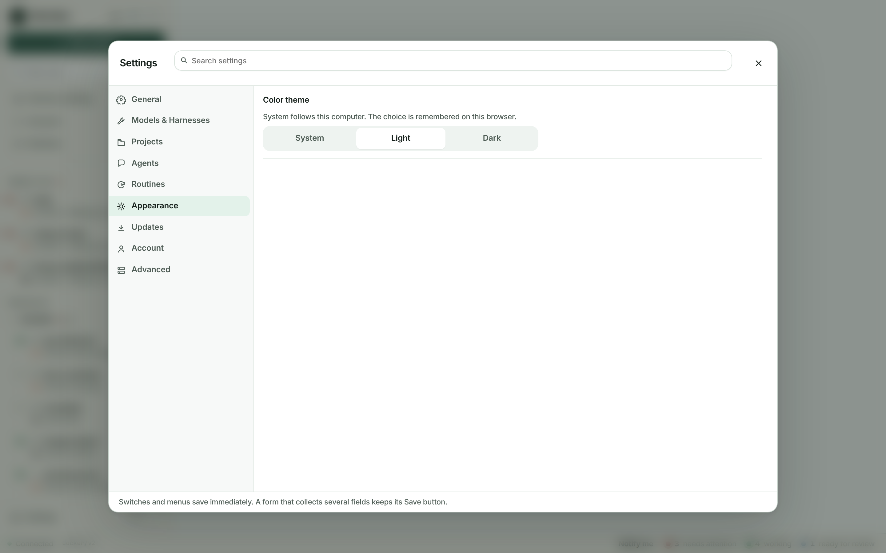

# Settings window

Settings is one dialog over the workspace. It opens from the cog at the bottom of the sidebar, and from `Cmd+,` on macOS or `Ctrl+,` elsewhere. Escape or the close button dismisses it. The screenshots were taken at 1440×900 on Linux, so the shortcut draws as Ctrl+, . On macOS it draws ⌘,.

The section list is pinned to the left edge. In the content pane, each heading, label, and control starts at the left, and the control sits under its label. Switches and menus save immediately. A form that collects several fields keeps its Save button.

Every setting is an entry in `frontend/src/settings/registry.tsx`. Adding one means adding an entry there. Search matches the entry's name, description, and section.

## Where it sits

The cog takes the bottom footer slot. The theme cycle is gone from the footer. Theme is changed only under Appearance, and the saved `meridian.theme` value still applies on the next launch.

Commands is not in the sidebar list. The palette still opens with `Cmd+K` or `Ctrl+K` from anywhere. The visible control is in the sidebar header, to the right of the name: the command mark and the shortcut. The activity filter under New project still only narrows the list, and `/` still focuses it.

## Sections

| Section | What it holds |
| --- | --- |
| General | Setup-change check, git commit identity, desktop alerts, the harness remembered for a new project |
| Models & Harnesses | Default connection per harness, harness setups, provider connections |
| Projects | Packs, checks, environment, and which Threads receive notes, for the project chosen at the top of the section |
| Agents | Pause without you, run at once, cleanup, and approve-each-spawn for the open lead. With no lead open, the controls show the defaults and stay disabled |
| Routines | The routine list and editor |
| Appearance | Color theme: System, Light, or Dark |
| Updates | Check for updates. In a browser this explains that checks run in the desktop app |
| Account | Sign-in, GitHub, sessions, personal access tokens, and members |
| Advanced | Station, team mode, and whether the provider gateway is on |

Harness settings, Account, and Routines in the sidebar open those sections. So do the old addresses `/ui/settings/harnesses`, `/ui/settings/account`, and `/ui/routines`, including a hash such as `#github` or `#import-setup`. The project page stays. It is where you read that project's notes, start a Capsule, and delete the project. The same project settings are also in Settings, under Projects.

